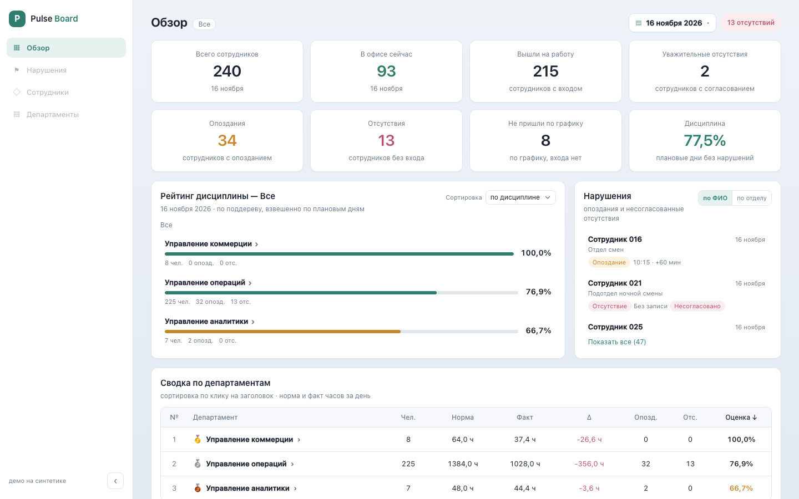
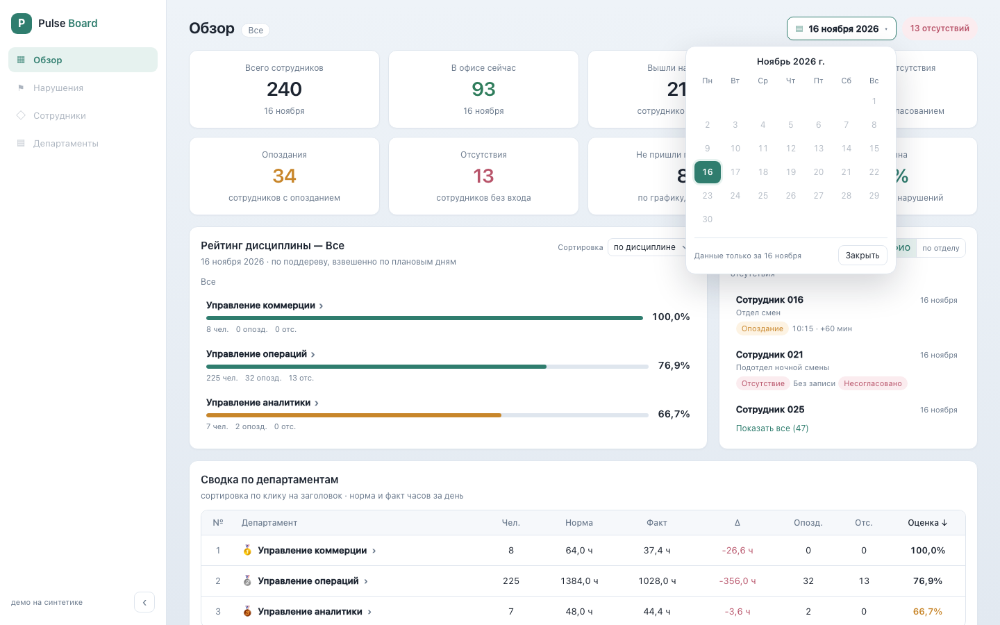
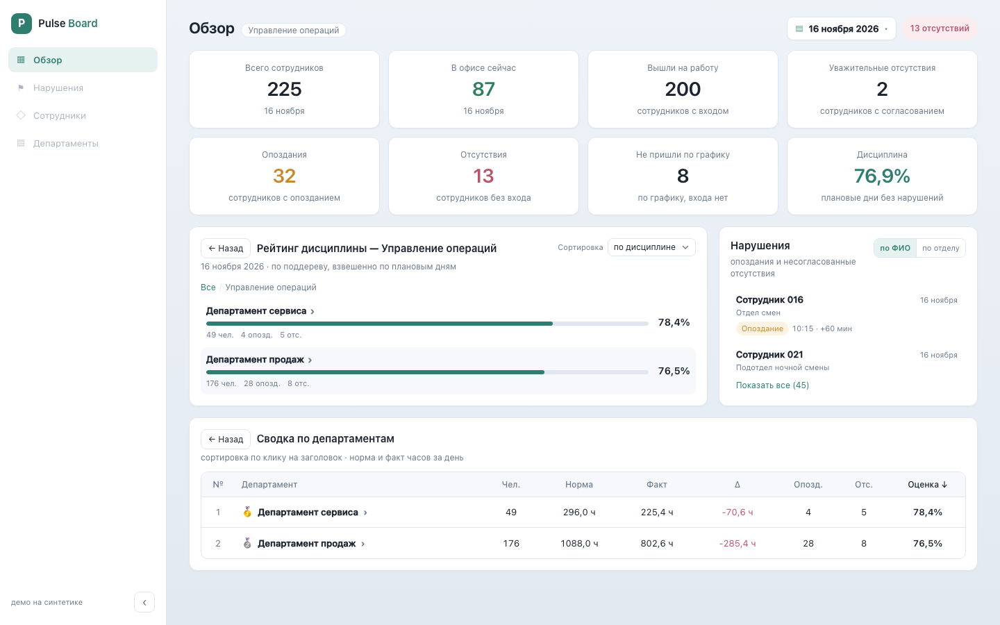
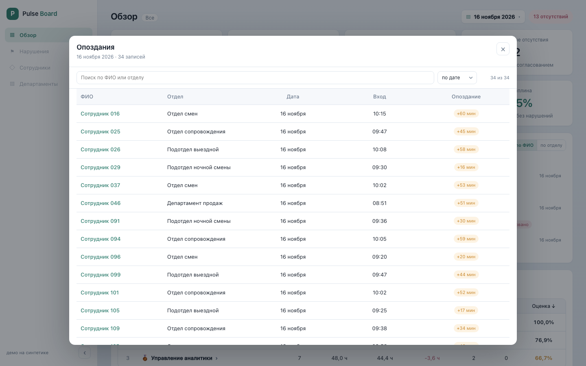
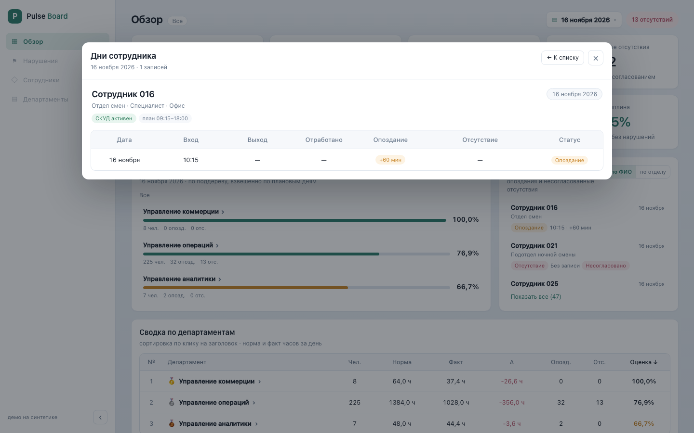
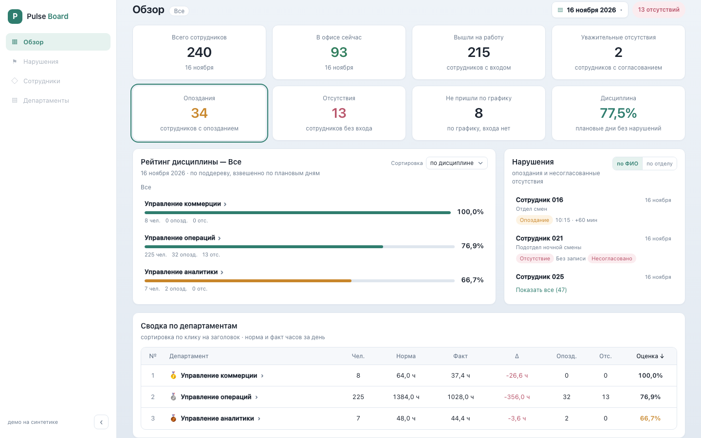

# Pulse Board — отчёт по посещаемости

Одностраничный отчёт для руководителя: кто был в офисе, кто опоздал, кто не
пришёл, и как выглядит дисциплина по подразделениям. День один и уже
завершён — **16 ноября 2026**. Календарь эту дату показывает, но выбрать
другую нельзя.

Данные синтетические. Нет реальных имён, пропусков и событий.

**Демо:** <https://tkachambus.github.io/bi-dwh-showcase/>



## Что внутри

| Слой | Что делает |
|---|---|
| События и справочники | проходы, отсутствия, календарь, люди, подразделения |
| Витрина дня | полная сетка «сотрудник × день», в том числе дни без прохода |
| Отчёт | карточки, рейтинг, нарушения, сводка и карточка сотрудника |
| Снимок | тот же расчёт в браузере, без живой базы |
| Проверки | повторная загрузка, дубли, опоздания, отсутствия, сверка формул |

Интерфейс — одна страница, без UI-библиотек. Списки открываются поверх неё.

### Экран

- Шапка: дата отчёта и число отсутствий. Глубина дерева в шапке не выбирается,
  она меняется только при провале внутрь подразделения.
- Восемь карточек: всего сотрудников, в офисе сейчас, вышли на работу,
  уважительные отсутствия, опоздания, отсутствия, не пришли по графику,
  дисциплина. Считаются сотрудники за этот день, не «дни за период».
- Рейтинг дисциплины и сводка. После провала кнопка «← Назад» стоит слева
  от заголовка в обоих блоках.
- Списки по карточкам: поиск, сортировка, переход в карточку сотрудника.
- Карточка сотрудника — одна строка за 16 ноября, без выбора периода.







## Как устроен расчёт

```
проходы ─┐
отсутствия├─► сетка «сотрудник × день» ─► снимок отчёта
календарь ┘              │
                         ├─► карточки, рейтинг, сводка
                         └─► списки и карточка сотрудника
```

- **Полная сетка.** В ней есть и дни без событий. Поэтому отсутствие, план и
  норма не зависят от того, пришёл человек или нет.
- **Один расчёт.** Те же правила работают и при сборке страницы, и в браузере.
- **Сверка.** Отдельный прогон повторяет формулу по строкам витрины и
  сравнивает дисциплину по каждому подразделению.
- **Поддерево.** Управление показывает всех людей вложенных департаментов
  и отделов, а не только прямой уровень.
- **Снимок.** Публичная страница читает готовый снимок и базу не поднимает.

Генератор умеет собрать историю длиннее одного дня. Экран всё равно
показывает только день снимка.

### Правила метрик

| Показатель | Правило |
|---|---|
| Плановый день | рабочий день, график «офис» или «смена», нет согласованного отсутствия |
| Опоздание | первый вход позже плана больше чем на 5 минут; только офис и смена |
| Отсутствие | рабочий день без входа; согласованное — причина подтверждена |
| Дисциплина | `(план − опоздания − несогласованные отсутствия) / план × 100`, 1 знак |
| День отчёта | всегда день снимка; день считается завершённым |
| Не пришли по графику | по графику должны были прийти, входа и согласованной причины нет |
| Норма | 8 часов на плановый день |
| Факт | сумма закрытого времени, потолок 16 часов на день |
| В офисе сейчас | последняя отметка дня — вход |
| Нет пропуска | человек виден в списках, но в опоздания и дисциплину не входит |

Удалённые и выездные графики не имеют фиксированного прихода: в опоздания
и дисциплину они не попадают, отсутствия у них видны.

## Ссылка на экран

Состояние страницы живёт в адресе, ссылку можно отправить как есть.

| Параметр | Значение |
|---|---|
| `date` | день отчёта; всегда 16 ноября 2026, другое значение игнорируется |
| `node` | выбранное подразделение; пусто — весь контур |
| `h` | путь провала, чтобы «Назад» вернуло на предыдущий уровень |
| `view` | открытый список |
| `eid` | карточка сотрудника |

Уровень дерева в адрес не пишется. Закрытие списка и «Назад» не плодят
лишнюю историю, провал внутрь подразделения — плодит, поэтому кнопка
«Назад» браузера возвращает по уровням.

## Данные

Сид детерминированный: повторный запуск не плодит дубли.

- 12 подразделений на 5 уровнях вместе с корнем «Все»:
  3 управления → департаменты → отделы → подотделы;
- 250 человек, из них 240 активных; часть без пропуска;
- графики: офис, удалённо, выезд, смена;
- отчётный день фиксирован в снимке. Интерфейс показывает только его.

## Запуск

Нужен Docker. Отдельная установка языка и базы не требуется.

```bash
docker compose up -d --build
```

- приложение: <http://localhost:4321/>
- имя базы, пользователь и порт — в `docker-compose.yml`, не здесь
- в логах сида: `seed done`, затем снимок и запуск приложения

Пересобрать данные:

```bash
docker compose run --rm seed
docker compose restart app
```

Остановить: `docker compose down`. Вместе с томом: `docker compose down -v`.

Проверки:

```bash
docker compose run --rm test
```

Покрыто: повторная загрузка того же пакета не плодит строки; неполный снимок
отсутствий отвергается; дубли не размножаются; опоздание только после
5 минут и только для офиса и смены; дисциплина витрины и отчёта совпадает
по всем подразделениям.

Статическая сборка читает готовый снимок и базу не требует:

```bash
cd app
STATIC_SNAPSHOT=1 BASE_PATH=/bi-dwh-showcase npm run build:static
```

## Ограничения

- Только десктоп: уже 1024 px появляется горизонтальная прокрутка.
- Нет входа, выгрузки и отдельных страниц: отчёт сознательно один.
- Сменный график в демо тоже считается как 8 часов.
